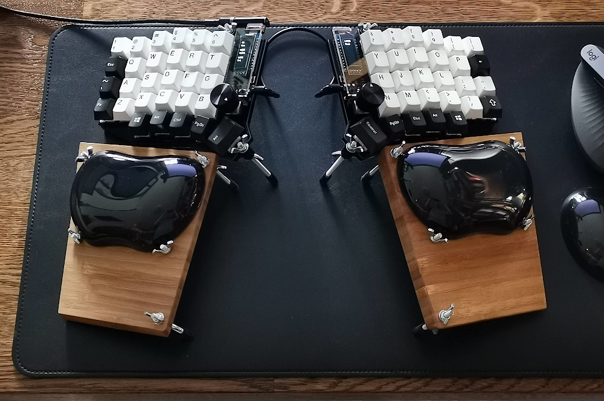

# Firmware for Sofle keyboard

Derived from the [default keymap](https://github.com/qmk/qmk_firmware/tree/master/keyboards/sofle/keymaps/default).

## Build and flash

See the [root README](../../../../README.md): `scripts/qmk compile -kb sofle/rev1 -km sekogan`,
then `scripts/build_all.sh --archive` and `scripts/flash-sofle.sh` once for **each half**
(double-tap that half's reset button).

The keyboard has no handedness configuration: the half with the USB cable acts as the
left half, so always connect USB to the **left** half.

## History

- The language feature broke somewhere between QMK 0.15.11 and 0.16.9; 0.21.3 and 0.23.6
  were fine again. The firmware in daily use since June 2024 was built from QMK 0.25.8.
