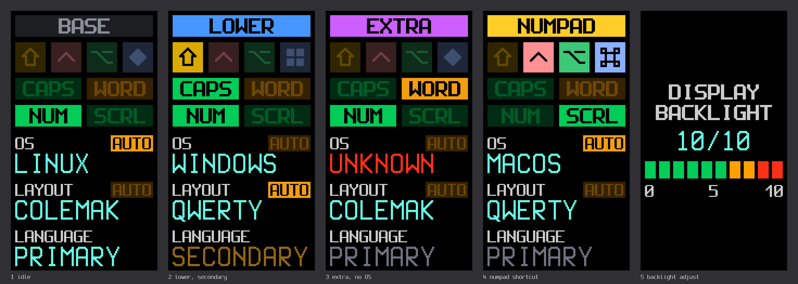

# Firmware for Halcyon Elora rev2

A keymap for the [splitkb Halcyon Elora](https://splitkb.com) rev2 split keyboard with a
Halcyon TFT display module on one half. It uses the same layers as the
[Sofle keymap](../../../../../sofle/keymaps/sekogan/readme.md), adapted to the Elora's
extra keys, and adds a color status display.

QMK target `splitkb/halcyon/elora/rev2`, keymap `sekogan`. The shared features are in
[`users/sekogan/`](../../../../../../users/sekogan/).

## Features

- **Six layers**: a base layer (QWERTY or Colemak), LOWER (symbols and F-keys), RAISE
  (navigation and editing), NUMPAD (held on R20, or toggled by tapping it; LOWER and RAISE
  still work on top of it), and EXTRA (LOWER + RAISE together: keyboard settings and media
  keys). The layer diagrams are at the top of [keymap.c](keymap.c).
- **QWERTY or Colemak**: BASE on EXTRA switches the base layout; the choice is remembered.
- **Two input languages**: L19 selects the primary language and R19 the secondary one, no
  matter what the host's current language is (Linux and Windows). While LOWER is held, the
  primary language is used, so symbols always come out right.
- **Instant QWERTY**: with the secondary language, the base layer acts as QWERTY so the host's
  Russian layout lands on its usual keys. While Ctrl, Alt or GUI is held, your chosen layout
  is back, so shortcuts stay where you expect them.
- **Compact Russian layout**: Right Alt + е types ё and Right Alt + ь types ъ.
- **OS selection**: the OS is detected automatically; OS on EXTRA cycles through Linux,
  Windows, macOS and back to autodetection. The language keys and the display follow the OS.
- **Caps Word**: press both Shifts to type one word in capitals; it turns off by itself, or
  when you tap a Shift.
- **Editing on RAISE**: arrows and page keys, previous/next word, line start/end, select
  word, delete word forward/backward, delete line, undo/cut/copy/paste, and "fast" up, down
  and space keys that repeat several times per press.
- **Num Lock** is kept on.
- **Media and display controls on EXTRA**: volume, previous/next track, mute, play/pause,
  and display brightness (BL+/BL-).

## Status display



The display shows, top to bottom:

- the active layer, each in its own color;
- Shift, Ctrl, Alt and GUI tiles, lit while the modifier is held (the GUI icon
  follows the OS);
- Caps Lock, Caps Word, Num Lock and Scroll Lock;
- the OS, the layout and the language, with an AUTO tag while OS autodetection or instant
  QWERTY is in effect.

BL+ or BL- shows the brightness level for a moment. The display turns off after two minutes
without typing and while the computer sleeps; the next key turns it back on.

Display design rules (default skin): [display_skin.md](display_skin.md).

## Hardware

- Two Elora rev2 halves; the display half carries a Halcyon TFT module, the other half no
  module.
- Always connect USB to the **display half**: only the half with USB draws on the display.
- Both halves run the same firmware.

## Build and flash

You need `git`, `make`, and rootless [Podman](https://podman.io): the compiler and the QMK
CLI run in a pinned container image, so nothing else has to be installed. See the
[root README](../../../../../../README.md) for setup.

```bash
make release        # builds build/firmware/qmk-<QMK version>-<VERSION>/elora.uf2
make flash-elora    # flash one half; run it again for the other half
```

`make flash-elora` waits for you to double-tap the reset button of the half. The bootloader
appears as a USB drive called `RPI-RP2`; the script copies `elora.uf2` there and the half
restarts by itself. Both halves take the same file. `make flash-elora FW=<dir>` flashes
another build, e.g. `FW=build/scratch/check` after a plain `make`.

## Fonts

- Labels: [Leggie](https://memleek.org/leggie/) by Wiktor Kerr,
  [CC BY 4.0](https://creativecommons.org/licenses/by/4.0/) (`graphics/LICENCE.leggie`).
- Values: a font derived from [Terminus Font](https://terminus-font.sourceforge.net/) by
  Dimitar Toshkov Zhekov, [SIL OFL 1.1](https://openfontlicense.org)
  (`graphics/OFL.terminus.txt`). It is not called Terminus, a Reserved Font Name.

Both were cropped to their inked rows and converted to QMK's font format; details in
[development.md](development.md#fonts).

Maintainer notes: [development.md](development.md).
